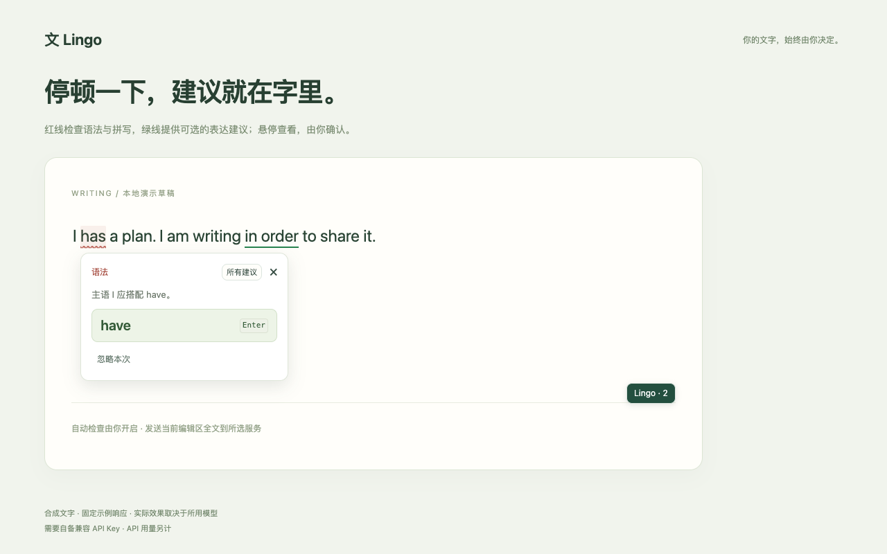

# Lingo

在网页里翻译、改写和检查文字的轻量 Chrome 扩展。

[安装 Lingo](https://chromewebstore.google.com/detail/imofdjefcigddmfpoifioiejgkfnomip) · [下载运行包](https://github.com/Noredge/lingo-chrome-extension/releases/latest) · [隐私政策](https://noredge.github.io/lingo-chrome-extension/privacy.html)



## 安装与使用

推荐从 Chrome Web Store 安装，需要 Chrome 120+。首次引导中填写服务地址、API Key 和模型，测试连接并按需授予网页访问权限。

手动安装：在 Releases 的 Assets 中下载 `Lingo-<版本>-webstore.zip` 并解压，在 `chrome://extensions` 开启开发者模式，选择「加载已解压的扩展程序」，打开包含 `manifest.json` 的文件夹。手动更新后重载扩展并刷新网页。

- **翻译与改写**：选中文字后点击「文」，支持校对、自定义预设、结果对比和继续调整；在支持的编辑区可确认后替换原文。
- **行内建议**：按需开启自动检查，输入停顿后查看红色语法／拼写提示和可选的绿色表达建议。悬停查看，点击接受或忽略，支持撤销与个人词典；检查按钮可隐藏，也可右键手动检查输入框。
- **单词与短语**：查看释义、搭配和例句。
- **PDF 与复杂编辑器**：PDF 划词后右键翻译；Google Docs 等复杂编辑器可打开侧边栏，粘贴原文、处理后复制结果。

浮窗可拖动、缩放，原文可编辑。界面支持简体中文、繁體中文和 English；翻译目标语言独立设置。

## API 与隐私

需要自备 API Key，用量由所选服务商计费。默认连接 OpenAI，也支持自定义 Base URL 的 Responses API 服务（仅支持 `/responses`），可保存多套配置。

请求直接发往所选服务。自动检查默认关闭，开启后会发送当前编辑区全文，包括邮件草稿。扩展不持久保存原文和结果；Key 默认在本机加密保存，也可选择密码加密或仅会话保存。详见[隐私政策](https://noredge.github.io/lingo-chrome-extension/privacy.html)。

## 开发

需要 Node.js 22.12+ 和 npm。

```sh
npm ci
npm run typecheck
npm test
npm run build
```

构建后，在 `chrome://extensions` 加载生成的 `dist/` 文件夹。

浏览器测试与截图生成另需运行 `npx playwright install chromium`；回归命令见 `package.json` 的 `test:*`。发布打包另需 Python 3，构建后运行 `npm run store:assets && npm run package:store`。

[问题反馈](https://github.com/Noredge/lingo-chrome-extension/issues) · [MIT License](LICENSE) · Noredge
